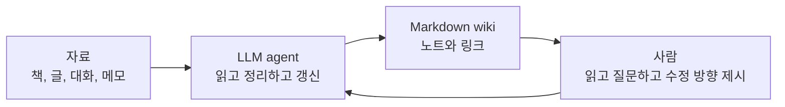
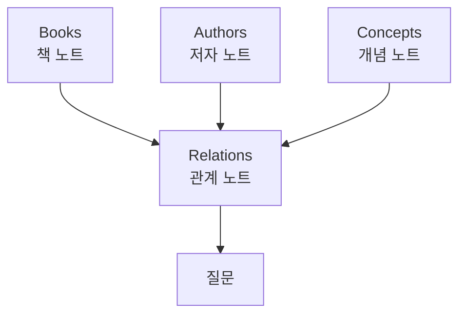
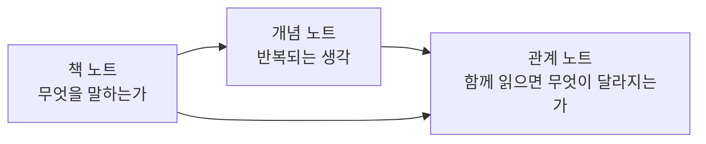
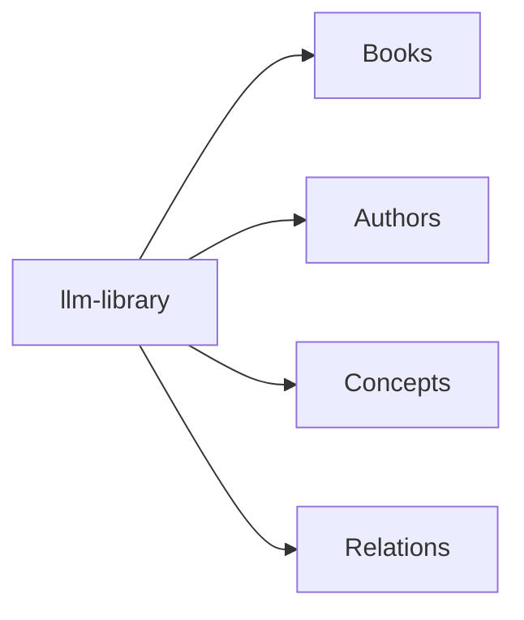
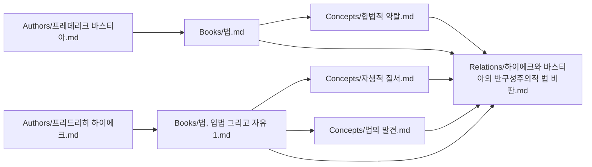
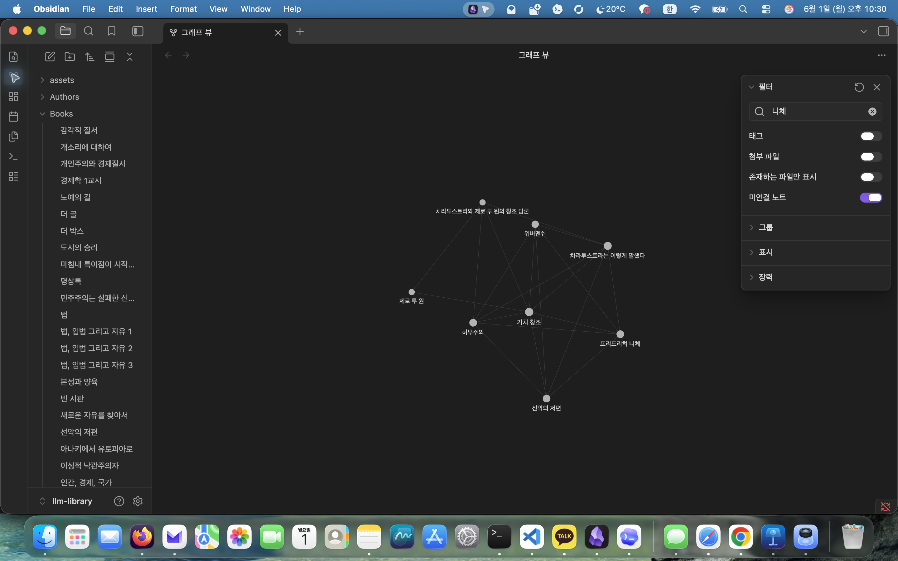
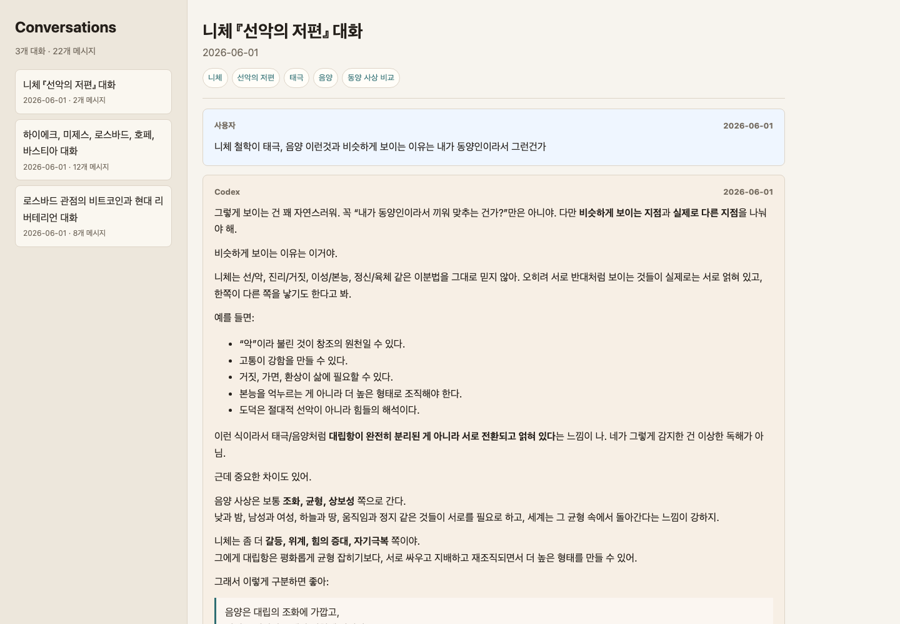
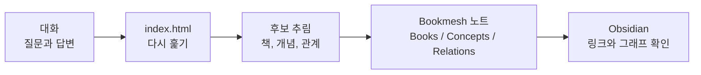

# 소개

1. LLM Wiki라는 방식이 무엇인지,  
2. 그 방식을 어떻게 책 지식 정리에 적용했는지,   
3. 그리고 실제로 어떤 결과가 나왔는지 소개합니다.

## 1. LLM Wiki란 무엇인가

일반적인 LLM 사용은 대화 중심입니다.  
질문을 하면 답이 나오고, 대화가 끝나면 그 답은 채팅 기록 안에 남습니다.

이 방식은 짧은 질문에는 충분합니다.  
하지만 어떤 주제에 대해 자료가 쌓이고, 개념 사이의 차이를 비교하고,  
예전 대화에서 나온 생각을 다시 이어가려면 한계가 생깁니다.  
좋은 답변이 나와도 그것이 지식 구조 안에 들어가지 않으면  
다음 질문에서 다시 출발해야 합니다.

Andrej Karpathy가 정리한 [LLM Wiki](https://gist.github.com/karpathy/442a6bf555914893e9891c11519de94f)가 이에 대한 대안입니다. LLM이 매번 답만 하는 것이 아니라, 답하면서 생긴 정리와 연결을 Markdown wiki에 남기고, 그 wiki는 다음 질문의 출발점이 됩니다.

핵심은 지식이 한 번의 답변으로 끝나지 않는다는 점으로 LLM이 만든 요약, 개념, 비교, 관계가 파일로 남고, 다음 작업에서 다시 사용됩니다.

여기서 중요한 차이는 "LLM에게 파일을 읽게 하는 것"이 아니라 "LLM이 파일을 관리하게 하는 것"이라는 점으로, 단순 RAG에서는 LLM이 자료를 읽고 답하지만 LLM Wiki에서는 agent가 노트를 읽고, 필요한 파일을 만들고, 기존 노트를 고치고, 링크를 추가합니다.

Karpathy의 설명에서 중요한 구성은 하기 세가지 입니다.

- 원자료: 사람이 모아둔 책, 문서, 글, 대화
- wiki: LLM이 관리하는 Markdown 노트
- 규칙: LLM이 어떤 형식으로 노트를 만들고 갱신해야 하는지 알려주는 지침

이 세 가지 중에서 가장 중요한것이 규칙으로, LLM이 아무 형식으로나 요약하면 시간이 지나면서 wiki가 흐트러지기에, LLM Wiki에는 "어떤 폴더에 어떤 종류의 노트를 둘 것인가", "출처와 추측을 어떻게 구분할 것인가", "새 노트를 만들 때 어떤 템플릿을 쓸 것인가" 같은 규칙이 필요합니다.

정리하면 LLM Wiki는

- Markdown 파일을 지식 저장소로 씁니다.
- LLM agent가 그 파일들을 직접 읽고 고칩니다.
- 사람은 방향, 질문, 검토를 맡습니다.

로, 사람은 여전히 무엇을 읽을지, 어떤 질문이 중요한지, 어떤 연결이 과한지 판단해야 하기에 완전한 자동 지식 관리는 아니지만, 반복적인 정리, 링크 추가, 형식 맞추기, 관계 후보 작성 같은 일은 agent에게 맡기는 시스템입니다.

## 2. 이 프로젝트는 무엇을 차용했나

Bookmesh는 책, 저자, 개념, 관계를 Markdown 노트로 나누어 저장하고, 책들 사이의 연결을 계속 갱신하는 스킬입니다.

Karpathy의 LLM Wiki가 일반적인 지식 관리 패턴이라면,  
Bookmesh는 그 패턴을 책 중심으로 좁힌 것으로,  
책과 책 사이의 관계를 별도 노트로 관리합니다.

Bookmesh 스킬은 이 작업을 위한 규칙으로,  
"책 지식 wiki를 만들 때 Agent가 어떻게 행동해야 하는가"를 정한 지침입니다.  

1. 새 책을 추가할 때 어떤 노트를 봐야 하는지,  
2. 어떤 템플릿을 써야 하는지,  
3. 관계 노트는 어느 정도 깊이를 가져야 하는지,  
4. 사실과 해석을 어떻게 구분해야 하는지를 정합니다.

Bookmesh 스킬이 하는 일은 크게 네 가지로

- 기존 vault를 먼저 읽습니다. (전체 개념 파악)
- 책, 저자, 개념, 관계 노트를 정해진 형식으로 만듭니다. (신규 지식 생성)
- 관계 후보를 만들 때 표면적 연결과 깊은 차이를 나누어 씁니다. (지식간 관계 생성)
- 작업 뒤에는 링크와 형식이 깨지지 않았는지 확인합니다. (Linting)

Bookmesh에서 관계 노트는 관계가 왜 중요한지, 어디까지 연결할 수 있는지, 어디서 조심해야 하는지를 따로 적습니다.

그래서 Bookmesh 스킬은 관계 노트를 만들 때 몇 가지 질문을 계속 던집니다.

- 표면적으로는 무엇이 연결되는가?
- 방법론이나 세계관은 어떻게 다른가?
- 결론은 어디서 갈라지는가?
- 같이 읽으면 한쪽만 읽을 때 놓치는 것이 무엇인가?
- 이 연결이 과한 해석이 될 위험은 없는가?

예를 들어 [Relations/로스바드의 화폐론과 비트코인.md](<../Relations/로스바드의 화폐론과 비트코인.md>)는 로스바드의 화폐론을 기준으로 비트코인을 어떻게 볼 수 있는지 다룹니다. 비트코인이 정부 화폐 독점에 대한 대안처럼 보이는 지점과, 전통적인 오스트리아학파 화폐론에서 여전히 애매하게 남는 지점을 함께 정리합니다.

또 [Relations/하이에크와 바스티아의 반구성주의적 법 비판.md](<../Relations/하이에크와 바스티아의 반구성주의적 법 비판.md>)는 하이에크와 바스티아가 모두 법을 사회 설계의 도구로 쓰는 태도를 비판한다는 점을 다룹니다. 다만 바스티아는 재산권과 합법적 약탈의 문제로, 하이에크는 자생적 질서와 법치의 문제로 접근한다는 차이도 함께 봅니다.

이런 관계 노트는 다음을 함께 다룹니다.

- 두 사상가나 텍스트가 연결되는 지점
- 비슷해 보이지만 실제로 다른 논점
- 한쪽 관점으로 다른 주제를 볼 때 생기는 장점과 한계
- 같이 읽을 때 생기는 질문
- 관계를 과하게 해석하지 않기 위한 주의점

이 구조 덕분에 단순 책 요약보다 관계 발견이 가능합니다.

즉, 
1. 책 노트는 한 권의 내용을 정리합니다.
2. 개념 노트는 여러 책에서 반복되는 개념을 따로 잡아둡니다.
3. 관계 노트는 두 개 이상의 노트를 함께 읽을 때 생기는 차이와 연결을 기록합니다. 

이렇게 해두면 책을 추가할수록 단순 목록이 아니라 비교 가능한 구조가 생깁니다.  
새 책을 읽을 때도 기존 개념과 관계를 기준으로  
"이 책은 어디에 위치할 수 있는가", "기존 해석을 바꾸는가" 를 물을 수 있습니다.

## 3. 결과

결과물은 다음과 같은 폴더로 구성되어 있습니다.

위 구조에서 바스티아의 [법](<../Books/법.md>)과 하이에크의 [법, 입법 그리고 자유 1](<../Books/법, 입법 그리고 자유 1.md>)은 각각 책 노트입니다.  
두 책은 [합법적 약탈](<../Concepts/합법적 약탈.md>), [자생적 질서](<../Concepts/자생적 질서.md>), [법의 발견](<../Concepts/법의 발견.md>) 같은 개념 노트와 이어지고,  
다시 [하이에크와 바스티아의 반구성주의적 법 비판](<../Relations/하이에크와 바스티아의 반구성주의적 법 비판.md>)이라는 관계 노트로 묶입니다.  
그래서 한 책을 읽은 뒤 다른 책과 어떤 지점에서 연결되고 갈라지는지 추적할 수 있습니다.

## 4. Obsidian에서 보기

Bookmesh의 노트는 Markdown 파일이므로 Obsidian에서 그대로 열 수 있습니다. Obsidian의 그래프 뷰를 사용하면 노트들이 어떻게 연결되어 있는지 볼 수 있습니다.

그래프 뷰는 전체 지식 구조를 한 번에 보여줍니다. 특정 책이나 개념을 검색하면, 그 주변에 어떤 노트가 붙어 있는지 볼 수 있습니다. 예를 들어 니체 관련 노트를 검색하면 [선악의 저편](<../Books/선악의 저편.md>), [차라투스트라는 이렇게 말했다](<../Books/차라투스트라는 이렇게 말했다.md>), [위버멘쉬](<../Concepts/위버멘쉬.md>), [허무주의](<../Concepts/허무주의.md>), [가치 창조](<../Concepts/가치 창조.md>) 같은 노트가 함께 보입니다.

이 화면은 다음을 확인할 때 유용합니다.

- 어떤 책이 여러 관계의 중심에 있는지
- 어떤 개념이 여러 저자나 책을 연결하는지
- 아직 연결이 적은 노트가 무엇인지
- 새 관계 노트를 만들 만한 후보가 있는지

## 5. 대화예시

[대화 예시 HTML 열기](../index.html)

## 6. 사용하는 방식

Bookmesh를 사용하는 흐름은 단순합니다.

1. 책이나 대화에서 정리할 만한 내용을 고릅니다.
2. LLM agent에게 관련 노트를 읽게 합니다.
3. 새 책, 개념, 관계 노트를 만들거나 기존 노트를 갱신합니다.
4. Obsidian에서 링크와 그래프를 확인합니다.
5. 관계가 너무 약하거나 과하면 다시 수정합니다.

책 한 권을 추가할 때는 보통 [Books/](../Books/), [Authors/](../Authors/), [Concepts/](../Concepts/)가 먼저 늘어납니다. 어느 정도 읽고 질문이 쌓이면 [Relations/](../Relations/)가 중요해집니다.

예를 들어 다음 질문은 관계 노트로 이어지기 좋습니다.

- 미제스와 하이에크는 둘 다 자유주의자인데, 방법론은 어디서 갈라지는가?
- 바스티아의 법 개념은 하이에크의 자생적 질서와 어떻게 연결되는가?
- 로스바드의 화폐론으로 비트코인을 보면 무엇이 보이고, 무엇이 애매해지는가?
- 니체의 자기극복과 피터 틸의 창조 담론은 닮았는가, 아니면 다른가?

이런 질문은 단일 책 노트에 넣기 어렵습니다. 그래서 관계 노트를 따로 둡니다.

## 7. 정리

LLM Wiki는 LLM이 답변만 하는 것이 아니라, 답변 과정에서 생긴 정리를 Markdown 파일로 계속 남기는 방식입니다.

Bookmesh는 이 방식을 책 지식에 적용합니다. 책, 저자, 개념, 관계를 나누어 저장하고, 특히 책들 사이의 관계를 따로 관리합니다.

`llm-library`에서는 그 결과가 Obsidian vault와 정적 HTML 화면으로 나타납니다. Obsidian은 노트의 연결을 보는 데 쓰고, [index.html](../index.html)은 대화를 다시 훑으며 노트로 옮길 내용을 찾는 데 씁니다.
